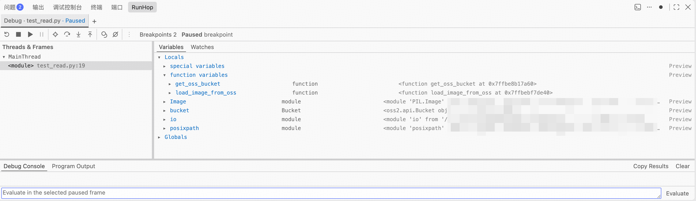

# RunHop

English · [简体中文](README.zh-CN.md)

**Local Code. Remote Runtime.**

RunHop is a VS Code extension that lets you write Python locally and run and debug it using the Python, Conda, and GPU environment on a remote server. The workflow feels like using a PyCharm SSH interpreter.

## Why RunHop?

**We love VS Code. We just hate the remote Python debugging workflow.**

We got tired of juggling Remote-SSH, Conda, code sync, remote paths, and debugpy just to run and debug Python on a server.

More importantly, we want **our development environment to stay local**.

We already have VS Code, Git, Claude Code, and Codex on our machines. Why move the entire workspace to a server just to use a remote GPU?

Installing and signing in to AI coding tools on every server takes time and can add authentication, security verification, and network hurdles.

We want to use remote compute while keeping the workspace local.

**Why move your workspace just to run Python?**

## Features

- **SSH Interpreter** — Use remote Python, Conda, and venv environments directly.
- **Remote Dependency Source** — Cmd/Ctrl-click an imported dependency to open its source from the default SSH interpreter. RunHop reads and saves the selected file over SFTP. Project source files keep their usual local navigation.
  VS Code settings `runhop.remoteSource.preconnect` and `runhop.remoteSource.idleMinutes` control SSH preconnection and the five-minute default idle timeout for source-only connections.
- **Remote Run & Debug** — Sync local code automatically, run it remotely, and debug with breakpoints.
- **Local Run & Debug** — Run with your local Python and debug with the debugpy bundled in RunHop. Local debugging requires Python 3.8 or later. Set the executable under **RunHop Configurations → Local Interpreter** or leave it blank for automatic detection.
- **PyCharm-like Debugger** — Step through code, inspect variables and the call stack, use watches and the Debug Console, and manage breakpoints.
- **Multiple Sessions** — Manage concurrent Run and Debug sessions and view each one's output and status independently.
- **Remote Terminal** — Open an interactive remote shell that initializes and activates the selected environment.
- **Local-First** — Keep VS Code, Git, and AI coding agents in your local workspace.

## Configure RunHop with an AI Agent

Give the following prompt to Codex, Claude Code, or another coding agent from the project root.

```text
Configure this project for RunHop without using VS Code Remote-SSH.

1. Inspect the repository and the existing `.vscode/runhop.json` before changing anything.
2. Keep the workspace and source code local. RunHop must use the configured SSH server only for remote Python execution, debugging, terminal sessions, and file synchronization.
3. If `.vscode/runhop.json` does not exist, create it. If an SSH host, username, authentication method, remote project path, or remote Python path is missing, ask me for that value instead of inventing it.
4. Keep all RunHop configuration in `.vscode/runhop.json`. Do not require a `launch.json` entry for a saved RunHop configuration.
5. Use this structure and replace the placeholders with real values:

{
  "targets": [
    {
      "name": "REMOTE_TARGET_NAME",
      "host": "SSH_HOST_OR_ALIAS",
      "username": "SSH_USERNAME",
      "port": 22,
      "remotePath": "/remote/project/root",
      "privateKeyPath": "~/.ssh/id_ed25519",
      "ignore": ["/datasets/", "/node_modules/", "/.venv/", "/__pycache__/"]
    }
  ],
  "interpreters": {
    "REMOTE_INTERPRETER_NAME": {
      "path": "/remote/conda/envs/ENV_NAME/bin/python",
      "target": "REMOTE_TARGET_NAME"
    }
  },
  "defaultInterpreter": "REMOTE_INTERPRETER_NAME",
  "syncMode": "incremental",
  "uploadOnSave": true,
  "runConfigurations": {
    "MAIN_RUN": {
      "program": "scripts/train.py",
      "runOn": "remote",
      "interpreter": "REMOTE_INTERPRETER_NAME",
      "cwd": ".",
      "args": [],
      "env": {},
      "download": ["outputs/"]
    }
  },
  "activeRunConfiguration": "MAIN_RUN"
}

6. `targets[].remotePath` is the remote project root. `interpreters.*.path` is a Python path on the server, not on this computer. `runConfigurations.*.program` and `cwd` are paths relative to the local project.
7. Use `syncMode: "incremental"` unless I explicitly request `full` or `off`. Keep `uploadOnSave: true` when local changes should be uploaded automatically. RunHop also watches eligible files written directly to the workspace by an AI agent or script.
8. `download` is an explicit list of remote files or directories to collect after a Run or Debug session exits. Do not download an entire project or dataset. Results are stored under `.vscode/runhop-results/`.
9. Never overwrite a remote file when RunHop reports a remote-change conflict. Report the conflict and ask before replacing the remote version.
10. Validate the JSON, check that the selected program exists locally, and explain which RunHop configuration is active. Do not modify the local Conda environment and do not install dependencies on the remote server just to initialize RunHop.
```

The same file is edited by **RunHop Configurations** and used by the RunHop Run and Debug commands. A missing `runhop.json` does not disable the extension. Create it when a remote run configuration is needed.

## Screenshot



## How It Works

```text
Local VS Code
├── Code / Git / Codex / Claude Code
└── RunHop
     ├── SSH Interpreter
     ├── Run / Debug
     └── Sessions
           │
           ▼
    Remote Linux Server
    Python / Conda / CUDA / GPU
```

## What's Next?

- A more complete PyCharm-style debugging experience
- Better debugging support for NumPy arrays and PyTorch tensors
- Multiprocess and distributed Python debugging
- **Agent-Friendly CLI** (planned) — Let Codex and other AI tools reuse configured remote execution environments without opening separate SSH sessions.

---

**Write here. Run there. Debug anywhere.**
