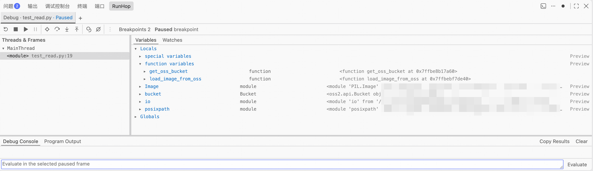
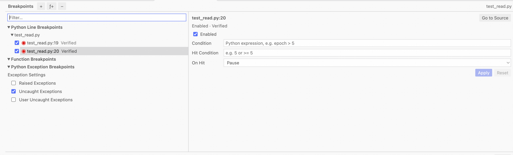

# RunHop

[English](README.md) · 简体中文

**Local Code. Remote Runtime.**

RunHop 是一个 VS Code 扩展，让你在本地编写 Python 代码，直接使用远程服务器上的 Python、Conda 和 GPU 环境运行与调试程序，获得接近 PyCharm SSH Interpreter 的开发体验。

## Why RunHop?

**We love VS Code. We just hate the remote Python debugging workflow.**

我们受够了为了在服务器上运行和调试 Python，就不得不折腾 Remote-SSH、Conda、代码同步、远程路径和 debugpy 的过程。

更重要的是，我们希望**开发环境始终留在本地**。

本地已经有 VS Code、Git、Claude Code 和 Codex。为什么只是想使用远程 GPU，就要把整个工作区迁移到服务器？

在不同服务器上重复安装和登录 AI 编程工具，不仅麻烦，还可能带来额外的认证、安全验证和网络环境问题。

我们需要的是远程计算资源，而不是远程开发工作区。

**Why move your workspace just to run Python?**

## Features

- **SSH Interpreter** — 直接使用远程 Python、Conda 和 venv 环境。
- **远端依赖源码** — 按住 ⌘（Windows/Linux 用 Ctrl）点击依赖符号，打开默认 SSH 解释器里的 Python 源码。RunHop 通过 SFTP 按需读写当前文件，项目源码照常在本地跳转。
  在 VS Code 设置中可通过 `runhop.remoteSource.preconnect` 开关预连，并通过 `runhop.remoteSource.idleMinutes` 调整源码专用 SSH 连接的空闲时间，默认 5 分钟。
- **Remote Run & Debug** — 本地代码自动同步，远程执行和断点调试。
- **Local Run & Debug** — 直接用本地 Python 运行，并使用 RunHop 随包提供的 debugpy 调试。本地调试需要 Python 3.8 或更高版本。可在 **RunHop 配置中心 → 本地解释器** 指定可执行文件，或留空自动检测。
- **PyCharm-like Debugger** — 单步执行、变量、调用栈、Watches、Debug Console 和断点管理。
- **Multiple Sessions** — 同时管理多个 Run / Debug 任务，独立查看输出和状态。
- **Remote Terminal** — 远程交互式 Shell，自动初始化并激活对应环境。
- **Local-First** — 保留本地 VS Code、Git 和 AI Coding Agent，无须迁移整个开发环境。

## 用 AI 初始化 RunHop 配置

在项目根目录把下面的提示词交给 Codex、Claude Code 或其他 Coding Agent。

```text
请在当前项目中初始化 RunHop，禁止使用 VS Code Remote-SSH。

1. 先检查仓库结构和现有的 `.vscode/runhop.json`，再修改文件。
2. 项目代码和 VS Code 工作区保持在本机。RunHop 只通过配置好的 SSH 服务器执行远程 Python、运行 Debug、打开远程终端和同步文件。
3. 如果没有 `.vscode/runhop.json` 就创建它。如果 SSH 主机、用户名、认证方式、远程项目目录或远程 Python 路径缺失，必须向我询问，不能自行猜测。
4. 所有 RunHop 配置都放在 `.vscode/runhop.json`。保存的 RunHop 配置不需要依赖 `launch.json`。
5. 按下面的结构填写真实值并替换占位符：

{
  "targets": [
    {
      "name": "REMOTE_TARGET_NAME",
      "host": "SSH_HOST_OR_ALIAS",
      "username": "SSH_USERNAME",
      "port": 22,
      "remotePath": "/remote/project/root",
      "privateKeyPath": "~/.ssh/id_ed25519",
      "ignore": ["/datasets/", "/node_modules/", "/.venv/", "/__pycache__/"]
    }
  ],
  "interpreters": {
    "REMOTE_INTERPRETER_NAME": {
      "path": "/remote/conda/envs/ENV_NAME/bin/python",
      "target": "REMOTE_TARGET_NAME"
    }
  },
  "defaultInterpreter": "REMOTE_INTERPRETER_NAME",
  "syncMode": "incremental",
  "uploadPolicy": "safe",
  "uploadOnSave": true,
  "proxy": "http://127.0.0.1:7890",
  "runConfigurations": {
    "MAIN_RUN": {
      "program": "scripts/train.py",
      "runOn": "remote",
      "interpreter": "REMOTE_INTERPRETER_NAME",
      "cwd": ".",
      "args": [],
      "env": {},
      "download": ["outputs/"]
    }
  },
  "activeRunConfiguration": "MAIN_RUN"
}

6. `targets[].remotePath` 是服务器上的项目根目录。`interpreters.*.path` 是服务器上的 Python 路径，不是本机路径。`runConfigurations.*.program` 和 `cwd` 使用本地项目的相对路径。
7. 除非我明确要求，否则使用 `syncMode: "incremental"`，不要改成 `full` 或 `off`。需要自动上传本地改动时保留 `uploadOnSave: true`。RunHop 也会监听 AI 或脚本直接写入工作区的符合规则的文件。
8. `download` 只列出 Run 或 Debug 结束后需要取回的远程文件或目录。不要下载整个项目或数据集。结果会保存到 `.vscode/runhop-results/`。
9. RunHop 报告远端文件冲突时，不要直接覆盖远端文件。先报告冲突并等待确认。
10. 校验 JSON，确认选中的脚本在本机存在，并说明当前激活的 RunHop 配置。不要修改本机 Conda 环境，也不要为了初始化 RunHop 在服务器上安装依赖。
```

`uploadPolicy` 用于控制本地和远端文件冲突。`safe` 在覆盖前停止，`force_upload` 用本地文件替换远端文件，`force_download` 用远端文件替换本地文件，`interactive` 逐个询问冲突处理方式。`proxy` 会通过标准 HTTP 和 SOCKS 代理环境变量注入启动的 Python 进程。

使用 `scp` 或远程终端完成外部同步后，可以从项目右键菜单执行 **RunHop: Refresh Sync Baseline**。它只记录当前本地和远端的 fingerprint 与哈希，不会上传或下载文件。

项目级解释器填写在 `defaultInterpreter`。`scripts` 下可以按 Python 文件分别覆盖解释器、参数、工作目录、环境变量和调试选项。`runConfigurations` 中的命名配置可以从工具栏选择，并在该次运行中优先于项目和文件级默认设置。

**RunHop 配置中心**和 Run、Debug 命令使用同一份 `.vscode/runhop.json`。没有这个文件不会禁用扩展，需要远程运行时再创建即可。

同步基线现在保存在项目目录的 `.vscode/runhop-state/source-baselines/` 中。这里仅保存文件指纹和哈希，不保存文件内容。删除这些记录会重置冲突历史，下次同步时会重新建立基线。

## 效果截图





## How It Works

```text
Local VS Code
├── Code / Git / Codex / Claude Code
└── RunHop
     ├── SSH Interpreter
     ├── Run / Debug
     └── Sessions
           │
           ▼
    Remote Linux Server
    Python / Conda / CUDA / GPU
```

## What's Next?

- 更完善的 Debug 调试体验
- NumPy / PyTorch Tensor 调试增强
- 多进程与分布式 Python 调试
- **Agent-Friendly CLI** — 让 Codex 等 AI 工具复用已配置的远程执行环境，无需重复 SSH（规划中）

---

**Write here. Run there. Debug anywhere.**
